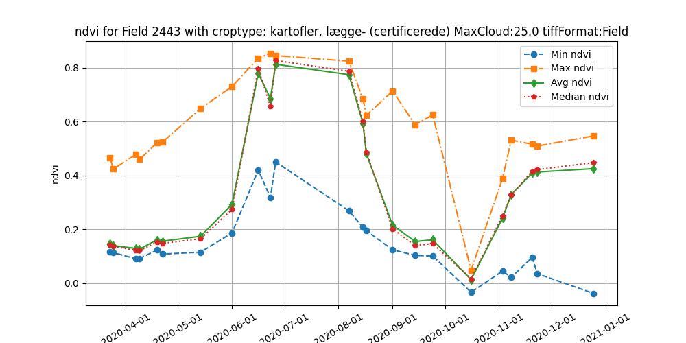
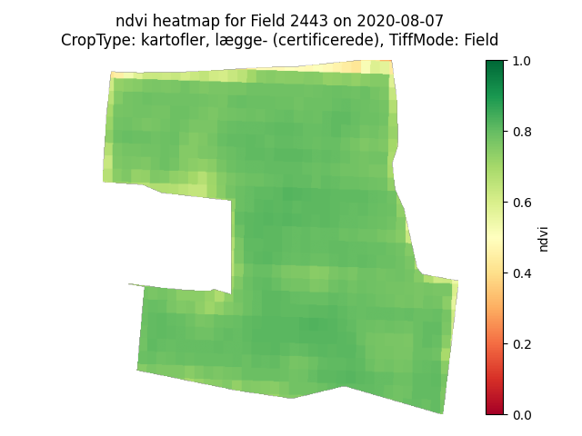
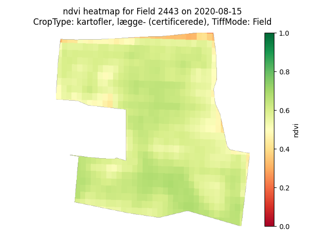
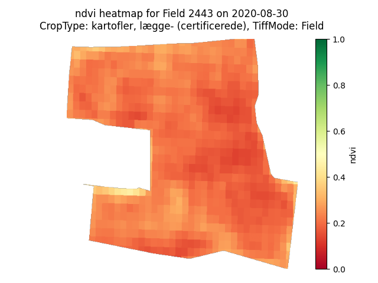
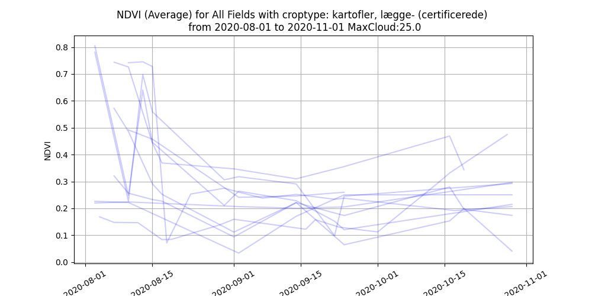
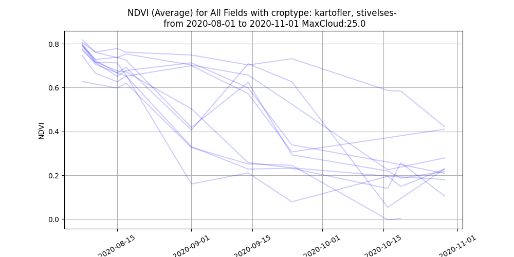
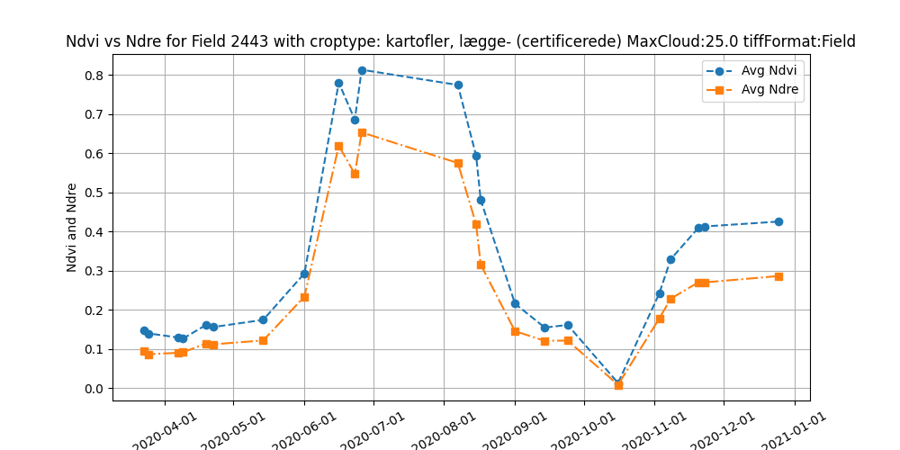

# Satellite-Based Detection of Pesticide Overuse

Master's thesis in Software Engineering at the University of Southern Denmark (June 2025), by
**Anton Christensen** and **Oskar Thomsen**, advised by Aslak Johansen. Built on a case from the
Danish Environmental Protection Agency (Miljøstyrelsen).

Write-up: **[My Master's Thesis: Satellite-Based Detection of Pesticide Overuse](https://oskar.kjaer-thomsen.dk/blog/masters-thesis-satellite-pesticide-detection)**



## The problem

Before harvest, seed potato farmers spray a desiccant that kills the plant above ground. The
chemicals can leach into groundwater and harm wildlife, so the agency regulates how much may be
used. Compliance is checked with soil samples, but there are fewer than a thousand inspections a
year (746 in 2019), and the sites are picked at random.

The idea: a desiccant makes a field's vegetation index (NDVI) drop, and that drop can be seen
from Sentinel-2 satellite data. A field whose NDVI drops faster than normal might have been
sprayed too heavily, and a ranked list of such fields is a better basis for inspections than
chance.

## What we built

A Python system that collects satellite data for every field of a given crop type in Denmark and
turns it into vegetation index time series:

1. **Database populator** (`Code/Database_Populator`) reads the agency's public GIS shapefile of
   all Danish fields, filters it by crop type, and stores each field's ID, crop type and polygon
   (as WKT) in MySQL.
2. **Download workers** (`Code/Download`) ask the Sentinel Hub Catalog API which dates have
   imagery for a field, including cloud cover, and download the raw spectral bands as GeoTIFFs
   from the Process API, per field or per bounding box.
3. **Processing workers** (`Code/Process`) read the GeoTIFFs with Rasterio, check the data mask
   for invalid pixels, calculate NDVI, NDRE, GNDVI and EVI per pixel, and store the results or
   render heatmaps and KDE plots.
4. **RabbitMQ** (`Code/RabbitMQ`) distributes the work. A work order is split into tasks of at
   most ten days, spread across the running workers.

Some of the engineering decisions:

- **Raw bands instead of ready-made statistics**, so the data can be checked per pixel, drawn as
  heatmaps, and used for new indices without downloading it again.
- **MySQL instead of a time series database**, because the data is relational and the schema
  kept changing during exploration.
- **Parallel worker processes** instead of threads, since the work is I/O-bound and Python's GIL
  rules out simple multithreading. With ten fields and 30 days of data, one worker took 119 s
  and four workers took 32 s.
- **Long tasks in RabbitMQ:** task execution moved to a separate thread with a callback, so the
  connection's heartbeat keeps running, with a two-hour timeout and tasks capped at ten days.
- **Bounding boxes or individual fields:** bounding boxes were about 29 times faster on Funen,
  but per-field downloads followed the field borders more closely. Both modes are kept.

## Results

On a typical seed potato field, NDVI rises from mid-May, holds just below 0.8 through June and
July, falls to about 0.6 between 7 and 15 August, which matches the timing of a desiccant, and
drops to near zero at harvest in October.

| 7 August | 15 August | 30 August |
|---|---|---|
|  |  |  |

Seed potatoes could also be told apart from starch potatoes, sugar beets and apple orchards by
their NDVI curves alone:

| Seed potatoes | Starch potatoes |
|---|---|
|  |  |

We developed three methods for scoring possible overuse, each producing a ranked list of fields:
comparing the decline of NDVI with that of NDRE (which measures deeper into the plant than the
leaf canopy), finding each field's steepest NDVI drop, and comparing the NDVI and NDRE gradients.



## Limitations

The scores could not be validated. The agency couldn't share ground truth (which fields were
sprayed correctly or too heavily) because of GDPR, and the farmers we contacted declined. Readings
with more than 25% cloud cover were too noisy to use, which left gaps of weeks on some fields.
The three methods ranked the same fields differently; the steepest-drop NDVI ranking was the most
reliable, and still a better starting point for inspections than random selection.

Next steps would be getting ground truth, comparing NDVI and NDRE over the whole desiccation
period, and, with enough ground truth, a machine learning model that also uses weather data.

## Tech stack

Python · Sentinel Hub API (Catalog and Process) · Rasterio · GeoPandas · Shapely · pyproj ·
MySQL · RabbitMQ (pika) · Matplotlib · Seaborn · Docker Compose · QGIS

## Repository structure

| Folder | Contents |
|---|---|
| `Code/Database_Populator` | Reads the GIS dataset, converts it to GeoJSON and inserts fields into MySQL |
| `Code/Download` | Download workers and the Sentinel Hub API handlers |
| `Code/Process` | Processing workers: vegetation indices, plots and statistics |
| `Code/RabbitMQ` | Scripts that create work orders and send commands to the workers |
| `Code/Shapefiles` | GIS data: field GeoJSON per year, and bounding boxes for Denmark and Funen |
| `Report/Sources` | Sources and test logs used in the thesis report |

## Setup

Inside the `Code` folder, start MySQL, phpMyAdmin and RabbitMQ, and install the Python
dependencies:

```bash
cd Code
docker compose up -d
python3 -m venv .venv
source .venv/bin/activate
pip install -r requirements.txt
```

Create a `.env` file in `Database_Populator` and in `Process`:

```env
SQLHOST="localhost"
DBUSER="user"
DBPASSWORD="password"
DBDB="db"
```

And one in `Download`, with Copernicus credentials as well:

```env
SQLHOST="localhost"
DBUSER="user"
DBPASSWORD="password"
DBDB="db"
ApiClienId=""
ApiClienSecret=""
APIToken=""
```

**Database:** with a GeoJSON file in `Shapefiles`, run the `Database_Populator` to insert the
fields. `Region_Checker` can then find the fields on Funen, to narrow the scope. In phpMyAdmin
(`http://localhost:8080`), add a Copernicus client ID and secret.

**Running:** start download or processing workers from their folder:

```bash
python3 Worker_Starter.py {number of workers} {log file name} {log folder}
```

Then create a work order with `new_Download_Work_Order.py` or `new_Process_Work_Order.py` in
`Code/RabbitMQ`, which assigns tasks to the workers.
